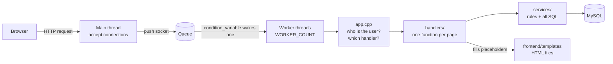

# Server Sync — a multithreaded e-commerce web server in C++ with MySQL

A small online store (shop + admin panel) whose **web server is written from scratch** in C++17 on top of
Winsock and the MySQL C API — no web framework. It is a PBL project that shows two ideas from our courses working
together in one real program:

* **Operating systems:** a *thread pool* — worker threads, a shared queue, a mutex and a condition variable.
* **DBMS:** *transactions*, primary/foreign keys and constraints — the checkout either happens completely or not at all.

| Home | Product | Cart |
|---|---|---|
|  |  |  |

| Checkout | Admin dashboard |
|---|---|
|  |  |

## 1. Problem and users

A shop must show products, take orders and keep stock correct — even when several people click at the same time
(two shoppers buying the last unit, an order saved without its payment, a cancelled order that never returned its stock).

* **Shopper:** browse and search products, keep a cart, place a *Cash on Delivery* order, see order history, cancel an order
  before it is delivered, sign in/out (each login is stored as a session).
* **Admin:** see simple counts, add/edit/delete products, set stock, manage categories, process orders
  (PLACED → SHIPPED → DELIVERED, or CANCELLED), see the list of users.

A framework would hide exactly the parts this project is meant to teach (threads, locking, transactions, request parsing),
which is why the server is hand-written. The trade-off: it is a teaching project, not production software (see section 8).

## 2. Architecture



Each layer only talks to the one below it: **SQL lives only in `services/`, HTML only in `frontend/`, URLs only in `app.cpp`.**

```
backend/
  main.cpp               start-up: connect to MySQL, run the server (or --make-admin)
  config.h               constants: port, worker count, DB host/user/name, low-stock level
  app.cpp                static files, "who is this user?", and the list of URLs (one if per URL)
  core/                  http.*  (parse request, build response)   server.*  (sockets + thread pool)
                         template.*  ({{name}}, {{{name}}}, {{> file}})
  db/                    database.*  (one MySQL connection, dbMutex, dbRun/dbRows/dbQuote)
  services/              services.h (the list of all functions) + product, cart, order, user, admin .cpp
  handlers/              handlers.h + shop, auth, customer (cart/checkout/orders), admin .cpp + view.cpp helpers
frontend/                templates/ (HTML), static/css/style.css, static/js/app.js
database/ecommerce_db.sql   schema + sample data (15 categories, 52 products)
tests/                   concurrency_test.bat / .md
docs/                    viva_questions.md, images/
```

## 3. Database

```mermaid
erDiagram
    USERS ||--o{ USER_SESSIONS : "has logins"
    USERS ||--o{ CART : owns
    USERS ||--o{ ORDERS : places
    CATEGORIES ||--o{ PRODUCTS : groups
    CART ||--o{ CART_ITEMS : contains
    PRODUCTS ||--o{ CART_ITEMS : "is in"
    CART ||--o| ORDERS : "becomes"
    ORDERS ||--o{ ORDER_ITEMS : contains
    PRODUCTS ||--o{ ORDER_ITEMS : "is sold as"
    ORDERS ||--o| PAYMENTS : "paid by"

    USERS { int user_id PK
            varchar email UK
            varchar name
            varchar password "salted SHA-256"
            varchar role "CUSTOMER or ADMIN"
            timestamp created_at }
    USER_SESSIONS { varchar session_id PK
                    int user_id FK
                    boolean is_active }
    CATEGORIES { int category_id PK
                 varchar category_name UK }
    PRODUCTS { int product_id PK
               varchar name
               decimal price
               int stock
               int category_id FK }
    CART { int cart_id PK
           int user_id FK
           varchar status "ACTIVE or CHECKED_OUT" }
    CART_ITEMS { int cart_id FK
                 int product_id FK
                 int quantity }
    ORDERS { int order_id PK
             int user_id FK
             int cart_id FK_UK
             decimal total
             varchar status "PLACED SHIPPED DELIVERED CANCELLED" }
    ORDER_ITEMS { int order_id FK
                  int product_id FK
                  int quantity
                  decimal price "price when bought" }
    PAYMENTS { int order_id FK_UK
               decimal amount
               varchar method "COD"
               varchar status "PENDING PAID CANCELLED" }
```

Design notes: `cart_items` has `UNIQUE(cart_id, product_id)` (one line per product); `orders.cart_id` and `payments.order_id`
are `UNIQUE` (one order per cart, one payment per order); `order_items.price` copies the price so later price changes
do not alter old orders; money is `DECIMAL`, never floating point. The payment status follows the order status:
DELIVERED → PAID, CANCELLED → CANCELLED.

## 4. Build and run

**You need:** Windows, MySQL 8 (running), MSYS2 UCRT64 `g++` on `PATH`, and these two DLLs **in the project folder next to
`server.exe`** (they are not stored in git): `libmysql.dll` (from your MySQL install, folder `lib`) and
`libwinpthread-1.dll` (from `C:\msys64\ucrt64\bin`).

1. **Create the database:** run `database/ecommerce_db.sql` in MySQL Workbench (tables + sample data, once).
2. **Set the MySQL password** — it is *not* in the code, only in an environment variable (same window as the next steps):
   ```
   set ECOM_DB_PASS=your_mysql_password
   ```
3. **Build:** `build.bat` (runs one `g++` command and creates `server.exe`; edit `MYSQL=` at its top if MySQL is installed elsewhere).
4. **Run:** `run.bat` (or `server.exe`) from the project folder, then open **http://localhost:8080**.
   The console prints `Server running on ...` and then one line per request, e.g. `[Worker 3] GET /products`.
5. **Make an admin:** sign up on the site, then run `server.exe --make-admin your@email.com`, sign in again and open **/admin**.

Settings (port, number of workers, DB host/user/name, low-stock level) are constants in `backend/config.h`; change and rebuild.

## 5. How checkout works

`placeOrder()` in `backend/services/order_service.cpp` runs as **one database transaction**:

1. take `dbMutex` and find the user's active cart;
2. `START TRANSACTION`, then `SELECT ... FOR UPDATE` the cart items with their product rows (locks them in MySQL);
3. check that every quantity is at most the stock — otherwise `ROLLBACK` and show a message;
4. insert the **order**; for each item insert an **order item** and run
   `UPDATE products SET stock = stock - qty WHERE product_id = ... AND stock >= qty` (must change exactly 1 row);
5. insert the **payment** (Cash on Delivery, PENDING) and mark the cart CHECKED_OUT;
6. `COMMIT`. If any step fails the function runs `ROLLBACK`, so no half-finished order, payment or stock change is saved.

Cancelling (customer before delivery, or admin) runs another transaction: items go back into `products.stock`,
the payment becomes CANCELLED, the order becomes CANCELLED. A delivered order cannot be cancelled.

## 6. How the thread pool works

`backend/core/server.cpp`: the **main thread** only calls `accept()`, pushes the new connection on a queue and calls
`notify_one()`. `WORKER_COUNT` **worker threads** (started once) loop forever: wait on the `condition_variable` until the
queue is not empty, pop one connection, read the request, call `handleRequest()` (in `app.cpp`), send the response and close.
The queue is protected by `pendingMutex`; a separate `printMutex` keeps the `[Worker N] ...` console lines from mixing.

All workers share **one** MySQL connection, so only one may use it at a time: every service function starts with
`lock_guard<mutex> lock(dbMutex);`. This is simple and safe; the price is that database work is serialised.

## 7. Security notes

* The MySQL password is read only from `ECOM_DB_PASS`; nothing secret is stored in the repository.
* Text typed by users goes into SQL only through `dbQuote()` (escaping) and into HTML only through `{{name}}` (escaping).
* Passwords are stored as `sha256$salt$hash` (random salt, SHA-256 computed by MySQL). A slow hash such as bcrypt/argon2
  would be the production choice.
* Login sessions are random ids stored in the database; the cookie is `HttpOnly; SameSite=Lax`. Everything that changes shop data
  (cart, orders, admin edits) is a `POST`; logout is a plain link. Admin pages check the user's role in each handler.
* Not done: HTTPS, CSRF tokens, login rate limiting, password reset.

## 8. Limitations

* One shared database connection (serialises queries); one request per connection (no keep-alive); no HTTPS.
* Cash on Delivery only; no real payment gateway, no shipping address, no product images (emoji tiles by category).
* No automated unit tests; the checks are manual plus `tests/concurrency_test.*` (needs MySQL and the running server).

## 9. More

* `tests/concurrency_test.md` — how to test "two shoppers, one last item".
* `docs/viva_questions.md` — questions and answers for the viva.
* `CHANGES.md` — what was removed or merged during the simplification, and why.
